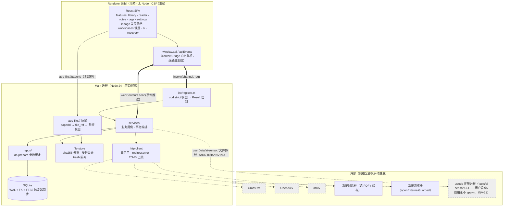
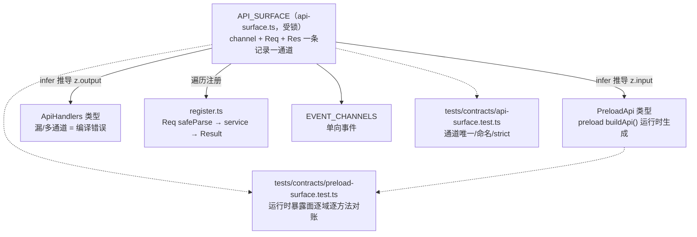
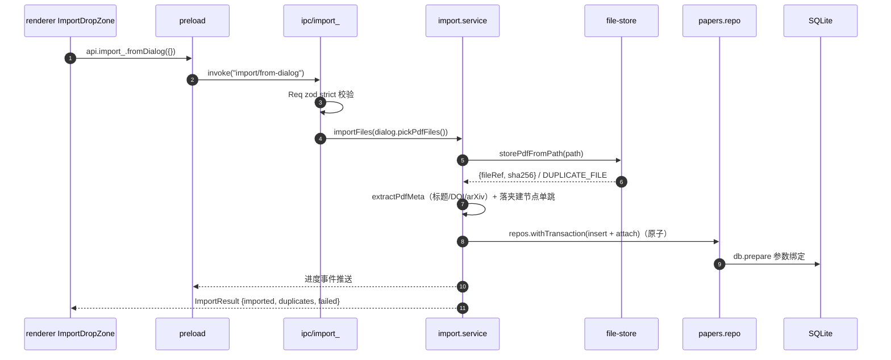
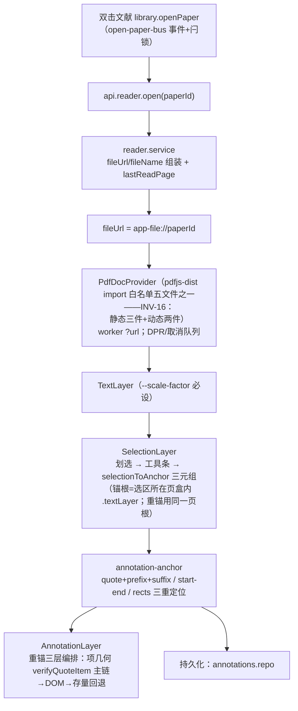
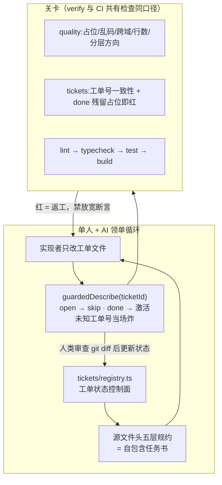
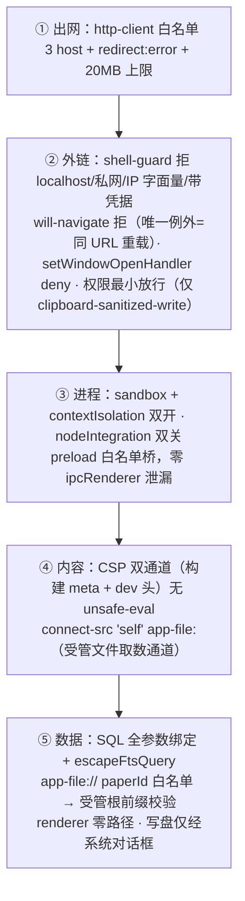

# 架构（architecture）

本文为活文档，描述当前工程现状；按裁剪版 arc42 六组组织。
模块职责的单源在每个源文件的头部规约注释里；跨模块行为不变量的单源在
`docs/invariants.md`；岗位与流程术语（主控/隔离一审/终审/红证/锚定）定义见
invariants.md「术语说明」。

## 1. 目标与约束

- **目标**：单人使用的本地学术文献管理 + PDF 阅读标注桌面应用；核心功能离线可用；
  AI 能力经伴随进程由用户手动触发（应用自身零 LLM 出网）。
- **技术栈**：Electron 44 + TypeScript 单语言全栈 + React 18 + better-sqlite3（FTS5）
  + pdfjs-dist v4；零 UI 框架以外的运行时重依赖（运行时依赖 6 个，预算 ≤15）。
- **硬约束**（强制面见宪法与 CI）：
  - 安全禁令：sandbox/contextIsolation 双开、renderer 禁 Node/路径、SQL 全预编译、
    CSP 无 unsafe-eval、出网白名单（详见 docs/security.md）。
  - 分层单向：`ipc → services → repos → db`；`renderer → window.api → ipc`。
  - 契约冻结：跨进程类型单源 `src/shared/`；测试/契约/迁移/配置变更须在提交说明申报（原 sha256 锁已退役）。
  - 明确不做清单：见 AGENTS.md「明确不做」。

## 2. 系统边界与方案策略



关键方案策略（决策全文见 §5 ADR 索引）：

- **结构化记录以 SQLite 为真源**：文献/笔记/标注/脉络等结构化业务数据驻
  SQLite；PDF/派生图表/恢复副本/设置驻受管文件系统。md 语料与 lineage.json
  为确定性投影导出（幂等、golden 锁定）；快照=带递增序号与随机 nonce 的
  加密信封（canonical 序列化仅在固定输入下字节确定，非幂等重放）。
- **课题隔离=库级分目录**（ADR-0018）：每课题一库一文件仓，切换=关旧库重建热换。
- **丢稿防御两道**：退出/关闭无条件握手 flush-first（ADR-0026）+ 恢复副本
  单槽覆写（ADR-0027/0029，慢盘不误判）。
- **folder↔graph 一一对应=结构性投影**：图身份≡lineage_nodes.folder_id，
  无独立 graphs 表（ADR-0025）。

## 3. 模块结构与关键运行流程

### 3.1 进程与分层

```
Renderer (React SPA, sandbox, 无 Node)
   │ 只经 window.api（preload contextBridge 白名单）
Main (Node)
   ipc/ 薄分发 ──→ services/ 业务用例 ──→ repos/ 数据访问 ──→ db/ (SQLite)
   workspace-layout（数据目录解析）+ data-layer.container（可重建 facade，switch 热换）
   file-store 受管文件   app-file:// 协议   http-client（host 白名单）
shared/ = 两进程共同 import 的唯一契约（类型 + zod 同源，冻结）
```

依赖规则（ESLint + check-quality 双重强制）：

- `renderer → shared`；`renderer ↛ main/preload/electron/node`（glob 含裸目录形式）
- `main → shared`；main 内 `ipc → services → repos → db` 禁跨层：ipc 禁 import repos/db；
  services 禁 import connection/migrations 与 main/ipc；**db 禁反向 import services/ipc
  及一切上层**。方向性规则由 check-quality 按解析后绝对路径强制（ESLint glob
  分不清 `shared/ipc` 契约与 `main/ipc` 层）
- renderer 内 features 域之间禁止互相 import（共享下沉 `renderer/shared`），
  由 check-quality 扫描

应用壳与窗口（main 侧 `windows/` + `bootstrap.ts`）：

- 窗口 bounds 持久化+屏幕夹取（`window-state.ts`）；单实例锁
  （requestSingleInstanceLock）。
- 启动主题注入链：main 同步读 settings 附 theme query →
  `src/renderer/public/theme-boot.js` 首帧写 dataset.theme（FOUC 兜底）→
  App effect=运行时单点（两者值一致，载入在途窗不回退——INV-71）。

### 3.2 契约机制（防漂移核心）



- `src/shared/ipc/api-surface.ts` 是 IPC 的**单一接线表**：通道名 + Req/Res zod schema。
- preload 按表生成桥（**CJS `.cjs` 输出**——沙箱渲染器不支持 ESM preload；zod 打进
  bundle）；事件桥形状 `PreloadEvents` 与全局声明 `env.d.ts` 同源，禁止两处手写。
- 所有响应 = `{ok:true,data} | {ok:false,error:{code,message}}`；`AppErrorCode`
  封闭枚举；错误可带可选 `reason`（结构化透传，首用=GHOST_FOLDER 询问）。
- CSP 单源：策略只在 `src/main/security/csp.ts`，构建期注入 index.html meta
  （生产 file:// 下 meta 是实际防线），源码 html 禁止手写。
- 契约文件（src/shared、测试、migrations、CI）变更须在提交说明中申报理由。
- 通道名→HTTP 路由天然映射（未来适配层命名约束）：api-surface 通道名
  「域/方法」天然映射 `/api/域/方法`——未来服务端或插件入站接口必须沿用
  同一命名（接线表即路由表；当前无 HTTP 服务，此为预留命名约束）。

### 3.3 数据模型（单迁移基线）

迁移链已压缩为单件 `026_baseline.sql`（ADR-0030）：新库 user_version 直达 26；
旧链升级舞步唯一消费者已随批清除；「迁移不可修改」例外与授权链见 migrate.ts
头注与 ADR-0030。实测基线：**22 表 + 4 个 FTS5 虚表 + 16 索引 + 59 触发器**。

| 域 | 表 |
| --- | --- |
| 文献库 | papers（21 列：folder_id NOT NULL 归属、is_starred 星标、cited_by 缓存三列、impact_factor）、collections（=文件夹，主图 `__main__` 禁删）、tags/paper_tags（域化标签：UNIQUE(folder_id,name)+挂接域守卫触发器+限额 20/6） |
| 阅读与笔记 | annotations（kind 三值 highlight/underline/note；定位器=W3C Web Annotation 思路 quote/prefix/suffix+startOffset/endOffset+rects/sortKey）、notes（paperId 1:1 全文笔记；title 死置空串）、ai_notes（AI 评估笔记，独立表） |
| 发展脉络 | lineage_nodes（paper_id 可空全局部分唯一——可空仅为遗留 DDL 兼容，应用层节点唯一来源=文献入库与移动两路（INV-NEW-1）；x/y/year/month/slot；core_idea/tags=留库死置列不入 DTO）、lineage_edges（UNIQUE(from_node,to_node)；dashed/color/via 视觉线型；from_anchor/to_anchor 钉定锚；kind/sub=留库死置列）、lineage_graph_meta（图级 KV：lineTypeNames）、floating_notes（画布悬浮笔记，无 paper_id） |
| AI 域 | ai_sessions/ai_messages/ai_tasks/ai_task_audit（任务系统）、ai_memory（跨会话记忆）、change_epochs（前缀缓存失效 epoch） |
| 治理与派生 | app_meta（库级身份 KV：owner uuid+设备 token）、deletion_events/deletion_log_guard（删除落账+防复活）、figure_jobs/paper_figures（图表提取派生资产，PNG-only） |

- FTS5 四虚表（papers/notes/annotations/ai_memory）全部 external content + 触发器同步
  （trigram，ADR-0003）。
- 标签唯一源=文献库域（tags+paper_tags）；脉络卡标签行=graph 读面伴生查表。
- pubNo=库级派生不落库（papers.queries PUBNO_ORDER 窗口，过滤不改编号）。
- 迁移只追加受锁；fkOff 重建模式守卫见 INV-123。

### 3.4 关键运行流程

导入全链（路径只存在于 main 侧；事务保证文献+挂接原子）：



阅读与标注锚定链（renderer 全程无文件路径；窗口尺寸变化=纯函数重算）：



### 3.5 域结构速览

**lineage（发展脉络图，第四视图）**

- 渲染域 `src/renderer/features/lineage/`：
  - 时间线=纵向「年+月」DOM 布局（TimelineYears；`.month-frame>.tl-row>.tl-card`
    砖砌网格；capacity.ts 容量公式纯函数族 N=⌊(W+72)/200⌋/M=⌊(W+72−100)/200⌋/
    奇行相位 100/数组序贪心分行/index↔(row,col) 双射；W=归一化内容盒宽
    readFrameContentWidth 单源；月框 border-box 最小宽 577px+配套四约束
    （`.tl-content` min-width calc(577px+140) 边层铺满/空图
    `:not(:has(.month-frame))` 守卫不铺/`.tl-card` flex-shrink:0 不压缩/
    `.timeline` overflow-x:auto 横向滚动）——ADR-0028/INV-169）。
  - 连线层=EdgeOverlay 双层 svg（可见层+命中层 z4）+ `routing/` 纯函数族
    （gap-cells 间隙单元→slots 槽位分配→zapply Z 形施加→residual 残余→chain
    六态链编排 direct→h-slip→detour→band→outer-ring→overlap；坐标集封闭=段坐标
    ∈锚/桩∪槽位集∪外圈车道集——ADR-0023/0024；detour=网格通道模型）。
    band 搜索域=源/目标纵区间内带 ∪ 目标行进方向续侧带 ∪ 目标背侧带（同行被挡
    零带承接——续侧带落锚=目标远侧锚先试、背侧带落锚=标准 endSide 序）；outer-ring=图域最外圈车道末级候选
    （routing/outer-ring.ts：四车道=最外障碍边∓(PAD+短桩 10)、每端候选锚经
    AnchorUse 散开、候选全序=曼哈顿长升序——「稀疏图 blocked=缺陷」的末级
    承接，排 overlap 之前，不消费槽位分配）。钉定端按锚外法线起落；自动路径在
    槽位与 jog 施加后经 finalize 的 r=6→3→0 最终采样净空门，三档均碰障则
    clearance='blocked'、d=''，可见/命中两层及编辑手柄、警示、虚影均撤销，
    按边提示一次，布局重算自动重试；selected 保留以便恢复后手柄回归，边数据不删，
    blocked 无几何元数据节点保留 data-anchors，占用发布跟随边数据而非路由成功。
    overlap 只豁免线-线槽位重合，不豁免线-卡相交；manual-override 同过终门
    （R2-C3）：障碍集=第三方（源/目标卡全链豁免——与穿卡警示 crossCardSegments
    单源语义对齐），碰第三方障碍=blocked 显式态，承接旧 via 与重排后非法 via；
    新 via 写入由提交门 edge-via-commit.ts 统一拦截（拖顶点/拖段含物化/双击
    加点/菜单删点与重置四口单点收敛——非法松手即回弹：零写零撤销单元零
    dirty+toast；via=null 清除免门直写回自动路由）。
  - 交互=use-edge-edit 调线态机+useDrawLine 画线+12 锚吸附
    （钉定锚体系）/ card-drag-grid 拖拽算术落点 /
    drag-autoscroll 四会话统一自动滚动（INV-80）。
  - 悬浮笔记=LineageFloatingNotes（交互门四源：edit∧select∧非 saving∧非 recovery 冻结——INV-149）
    +lineage-note-draft 草稿四落定（INV-150）。
  - 写路径=lineage-write-queue（FIFO；upsert 同 id 整替、patch-node 字段级融合）+recoveryScheduler（恢复副本）
    +lineage.store 编辑会话（beginUnit 快照式 undo/redo，保存成功清栈——INV-94）。
- main 域 `services/lineage/`（边守卫单口 upsertEdge 七校验：自环/悬空端点/
  跨图/重复边/成环/via/端点锚校验拒——INV-27；多父放行、kind 恒 'manual'；
  floating-notes.service）+`repos/lineage.repo(.rows)`+
  `lineage.write-guards.ts`（month/slot 归一+lineTypeNames 校验）。
- 排序契约=lineageOrder 唯一纯函数（shared/models/lineage.ts，三消费面禁双实现）。
- AI 可读导出=corpus 会话第六件套 lineage.json（递归 alphabetical 键序，golden 锁定）。

**workspaces（课题隔离）**

- ADR-0018 库级分目录：`userData/workspaces/<课题 id>/` 各含 synapse.db+files/
  （完全隔离——去重/FTS/备份天然按课题）；课题指针=userData/workspace.json。
- main 装配=`workspace-layout.ts`（数据目录解析）+`data-layer.container.ts`
  （可重建 facade：switch=关旧库→重建→热换，busy 串行守卫）。
- legacy-fresh 双态启动：全新首启不建 workspaces/（库在 userData 根），二启
  迁移入 workspaces/default。
- 渲染域=WorkspacesPage 管理页（卡片列表/新建/行内改名/点卡切换；dirty 确认→
  IPC switch→location.reload）；默认课题引导态（三条件判定+升格三路，INV-87）。

**ai-sensor（AI 伴随进程域）**

- ADR-0015 文件协议：`userData/ai-sensor/`（pending 任务/status.json 心跳/
  corpus-ai 产物/archive 账本）；工具侧=`tools/ai-sensor/` CLI；**应用永不 spawn**
  （INV-21）；observe 通道六态判定。
- 回灌事务性=清面+重插单篇事务（INV-67）；渲染消费=脉络侧板 AI 评估只读展示
  （LineageSideAiNotes——AI 显示单面，INV-105）+设置页 zcode 联动。

**AI 会话与记忆域（services/ai/）**

- ai-context：L1/L2 前缀注入面⊆epoch 集合 10 物理表（EPOCH_TABLES 单源；
  ctx_ver 前进⇒前缀缓存失效——INV-J）。
- ai-tail：尾段四个组成部分（消息窗/召回/文献展开/代理结果）恒现算，不入
  前缀缓存（INV-131）；isAgentEnvelope 识别谓词单源（INV-130）。
- ai-tasks：任务系统 dispatch+memory.create 写入围栏（跨锚 source_task_id
  同锚不变量——INV-128）。
- ai-memory-search：MATCH 与 LIKE 两路大小写同折叠（INV-127）。

**figure 域（图表提取）**

- `figure-tasks.service`（代际三守卫：token 在册+paper 在场+sha 同代）+
  `figure-store.service`（figure_jobs/paper_figures 两表；PNG 魔数守卫；
  24 上限；内容寻址 figures/<paperId>/<digest>.png）。
- 渲染消费=shared/figures/FigureExtractor（pdfjs import 白名单五个文件之一，
  动态 import）+PaperInfoSection 只读展示（app-file figure 分支协议取数）。

**recovery 域（恢复副本）**

- ADR-0027：单一 main recovery 服务+`<userData>/recovery/<wsId>/` 单槽覆写+
  RECOVERY_REGISTRY 类型注册表（shared/recovery/schemas.ts）；takeOver 超越
  （token+epoch 双校验）；epoch 删除屏障。
- ADR-0029 never-settle 治理：常态写永不因超时取消/判败；renderer 双阈值看门狗
  （T_slow=10s 降级呈现/T_stuck=60s 逻辑弃置+ghost 迟到对账）；main serialize 链
  per-key save 深上界 D_max=8；三档 chip（缓慢/未确认/不可用）。文件面保证：
  每（工作区,类型）单槽覆写；tmp 写全后 rename 原子替换；槽文件 0600；
  持久性=进程崩溃级（不承诺掉电）。关闭握手=main 状态机（close 一律
  preventDefault+flush-first；超时降级 confirm；取消经 quit-flush-abort
  解冻帧+bridge 有界复位——ADR-0026/INV-22）。

**snapshot 域（快照导出/导入）**

- `services/snapshot`：TABLE_SPECS 十表导出；导入按 id upsert+deletion_events
  防复活过滤（跨卷序列一致）；id 不复用（INV-132）。

**enrich 域**：CrossRef 被引数缓存（单调增长语义，INV-28）；含金量供给
（venue-tier 档位）。

## 4. 部署与横切约定

### 4.1 质量关卡链（本地 verify 与 CI 共有检查同口径；CI 另跑覆盖率/e2e/依赖审计/提交尾注检查）

本地 `npm run verify` 六段链（不含 e2e 与覆盖率）：quality → tickets →
lint → typecheck → test → build。

- quality 多段：占位/乱码/跨域/行数分级（repo≤300·组件≤250·CSS 450）/分层
  方向解析/同值双常量棘轮/CSS 字号+色值 token 负锚（AST inline 色规则驻
  eslint.config.js——quality 6b 段哨兵防回退）/CSS var() 语义锚/src 模型代号
  负锚/e2e 截图负锚/节点唯一来源负锚词表/src-main 冲突替换式删除负锚。
- tickets：工单号一致性/绑定对账/已裁决域对账（规则 6 以 ROADMAP 退役页
  `### P7-X：` 锚段集为已裁决域；done 票的 file 指向已删除文件时降级为
  note 观测——机制退役遗留定位符不卡 CI）。
- 独立快跑入口：`npm run lint:model-names`；CI 在共有检查之外另跑覆盖率
  （vitest --coverage）、e2e（Playwright 全量，需先 build）、npm audit 与
  [dep-change] 提交尾注检查。
- 受保护面（tests/shared/migrations/CI/检查脚本）变更须在提交说明中申报
  理由（原 sha256 锁与测试面指纹门已退役，凭申报与 diff 审查承载）。

### 4.2 工单与骨架期机制



- 每个文件头部五层规约（行为/接口/架构/生命周期/文化）=自包含任务书。
- 未完成实现=占位桩（调用即抛，工单 done 即删）或 UI 占位（`data-ticket` 徽标）。
- guardedDescribe 工单号必须与测试文件 import 的被测文件绑定（check-tickets
  第 5 关，防挂错块永久 skip）。

### 4.3 构建与原生绑定

better-sqlite3 13（N-API 版）：同一份 `prebuilds/<platform>-x64.node` 绑定
（linux-x64/win32-x64 等随 npm 包直发）跨 Node/Electron ABI 通用，双运行时无需
切换。Electron 42 起 npm 包无 postinstall：二进制首次 require 懒下载已前置到
npm ci 阶段。完整环境事实（Node 24 锁定等）=AGENTS.md「环境事实」单源。
打包：`npm run dist` NSIS（详见 DEVELOPMENT §7）。

### 4.4 安全边界（纵深，由外向内）



细节与机检锚=docs/security.md。

## 5. 架构决策索引（ADR）

决策正文=`docs/adr/`（背景/候选/裁决/后果+随件修订记录）。未建正件的编号其
决策单源在注记列。

| 编号 | 主题 | 正文单源 |
| --- | --- | --- |
| 0001 | Electron 单语言（纯 TypeScript 全栈） | docs/adr/ |
| 0002 | pdf.js 库 API 路线（非 embed/自绘替换） | docs/adr/ |
| 0003 | FTS5 触发器同步外部内容表（trigram） | docs/adr/ |
| 0004 | 工单注册表与受锁机制（registry+locks） | docs/adr/ |
| 0005 | 版本钉选向训练数据倾斜（版本以 package.json 为单源） | docs/adr/ |
| 0006 | Electron 升级门（prebuild 矩阵核查先行） | docs/adr/ |
| 0007 | 已登记取舍与地雷（登记性地雷在册） | docs/adr/ |
| 0008 | notes.store 五模块级结构维持分布式状态机（不坍缩） | docs/adr/ |
| 0009 | 零依赖性质测试（固定种子手写攻击序列） | docs/adr/ |
| 0010 | **永久空号**（预留位已实装，编号不复用） | — |
| 0011 | md 语料接口契约（导出六件套——幂等 sha 口径；v1 五件套+lineage.json 第六件=INV-77） | docs/adr/ |
| 0012 | 引文图数据模型（自动引文网络图维持不做） | docs/adr/ |
| 0013 | 备份/恢复姿态（不做自动机制+手动指引） | docs/adr/ |
| 0014 | lineage 图数据模型（人工策展时间树） | docs/adr/ |
| 0015 | AI 笔记回灌与伴随进程文件协议 | docs/adr/ |
| 0016 | 闲时会话预裁决表 | docs/adr/ |
| 0017 | 三阶段流程为默认运行模式（ai_sensor 通道域随批新立） | docs/adr/ |
| 0018 | 课题（Workspace）隔离=库级分目录 | docs/adr/ |
| 0019 | 划选反馈原生路线（自绘并集层） | docs/adr/ |
| 0020 | 应用改名与 userData 目录迁移 | docs/adr/ |
| 0021 | 文件夹单归属×脉络图绑定 | docs/adr/ |
| 0022 | 草稿导入链退役 | docs/adr/ |
| 0023 | 走线候选位分配=后处理槽位分配 | docs/design/2026-10-06_f-route02-design.md |
| 0024 | 砖砌网格布局+五态走线正统化 | docs/design/2026-10-07_f-slotgrid01-design.md |
| 0025 | DB 契约冻结（folder↔graph 投影/NOT NULL/app_meta/标签域化） | docs/design/2026-10-08_f-dbcamp01-design.md |
| 0026 | 关闭入口无条件握手化 | docs/adr/（细节=docs/design/2026-10-18_f-visfb64-design.md） |
| 0027 | 恢复副本统一管理 | docs/adr/ |
| 0028 | 时间线布局最小宽度（577px 地板） | 仓外档案区 scripts-audits/20261019-fvisfb67-impl/closeout-drafts.md（自标 ADR 草案——正式正文未建档，如需正式化须补立正件） |
| 0029 | 恢复副本常态写 never-settle 治理 | 仓外档案区 scripts-audits/20261020-nightb/recoV01/（design-v2.md+design-final-r3.md） |
| 0030 | 迁移链基线压缩（001–025 并单件 026） | 仓外档案区 scripts-audits/20261020-snapclean01/design-v2-final.md |
| 0031 | zod 3→4 安全升级 | docs/adr/ |

跨模块不变量=docs/invariants.md（「什么必须永远成立」；ADR 记「为什么」）。

## 6. 质量目标、已知风险与术语

**质量目标**

- `npm run verify` 全绿=合并门槛（共有检查与 CI 同口径——CI 另跑覆盖率与
  e2e）；收尾 push 后以 CI conclusion 复核（完成定义条款）。
- 覆盖率门槛：全局 70 / repos 85 / renderer 逻辑层 60（改 vitest.config.ts 须提交说明申报）。
- e2e 断言「看得见」=真实文本+计算样式（INV-06）；e2e 禁截图比对（INV-64）。
- 测试面单调性：契约面只增不减，有意收紧须用户裁决（INV-63）。

**已知风险与遗留**

- 登记性地雷与已接受取舍=ADR-0007；开放工单面=tickets/registry.ts（open 项）。
- CI 虚拟屏 1024×768 与本地 1280×800 不同构：新 e2e 用例凡 boundingBox+mouse
  拖拽/点击须先滚动锚定；双端拖拽用例须种子级同月共视设计（AGENTS.md 环境事实）。
- CI 合成输入栈无原生文本选区扩展：选区类 e2e 的选区产生一律走程序化写
  （INV-170②）。
- VMware 本地 e2e 偶发失败三族（输入事件/几何/窗口状态——FLK-01/02/03）：
  全天同一标准，红即红，
  非确定失败单现复跑定绿按通则（立案票 F-E2EFLK-01 承接根治）。

**术语**

主控/隔离一审/终审/红证/锚定/负锚/欠账等岗位与防线术语的定义单源=
docs/invariants.md「术语说明」；文档写作规范=AGENTS.md。
